# RoboWare UI ideas

Proposals for the next round of UI work on the final build (`C:\Users\jorge\roboware`). Nothing here is built yet. Tick the ones you want, cross out the ones you don't, and add notes next to any of them.

Effort: **S** takes about an hour, **M** about half a day, **L** a day or more.

The images are static mockups in the app's own clay style, drawn on the real default layout. The **purple tags** are annotations, not UI. To regenerate them, run `docs/ui-mockups/render.ps1`. The source is `docs/ui-mockups/mockups.html`.

---

## Where we are today

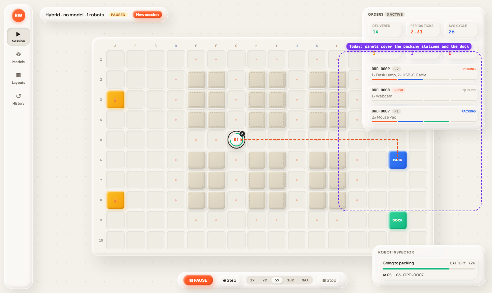

- **The HUD panels cover the map.** At 1440px the Orders drawer sits on top of the packing stations, and the Robot Inspector sits next to the dock.
- **The Session view has no sense of progress over time.** The KPIs are snapshots. Nothing shows whether throughput is going up or down.
- **The Robot Inspector shows one robot at a time.** You can't see the whole fleet at a glance.
- **Models and History are long, form-heavy pages.** They read like an admin tool next to the Session view.
- **The empty states are bare.** "No session running" is a single sentence and a button.

---

## A. Session view (the main screen)

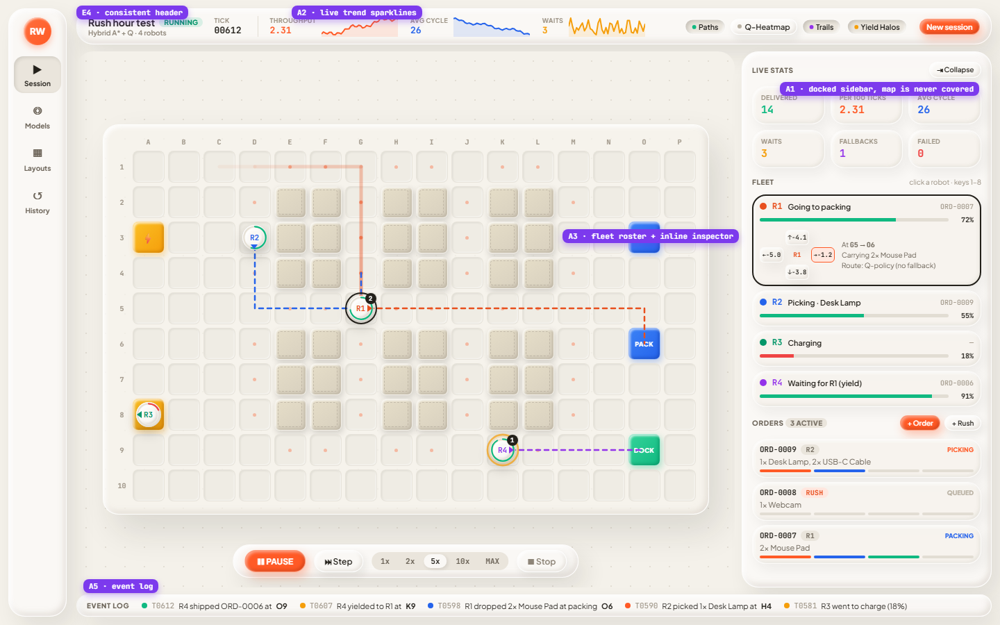

### A1. Docked sidebar instead of floating cards (M), *recommended*
Move live stats, the fleet and orders into a right-hand sidebar that can be collapsed, and fit the map into the space that's left, so the map is never covered. Collapsing the sidebar gives the map the full width.

### A2. Live trend sparklines (S)
Put throughput, average cycle time and waits in the header as tiny line charts over the last ~500 ticks. They show the trend that the KPI tiles can't.

### A3. Fleet roster with an inline inspector (M)
Give each robot a row with its colour, status in plain words ("Waiting for R1 (yield)"), a battery bar and its order. The selected robot's row expands to show the Q-value pad and its route. This replaces the separate inspector card.

### A5. Event log (S)
Show a scrolling feed along the bottom: "T0612 R4 shipped ORD-0006 at O9", "R4 yielded to R1 at K9". Clicking an event pans the map to where it happened.

### E4. Consistent page header (S)
Every view gets the same header row: a title, a context line, and the primary action on the right. You can see it at the top of every mockup.

---

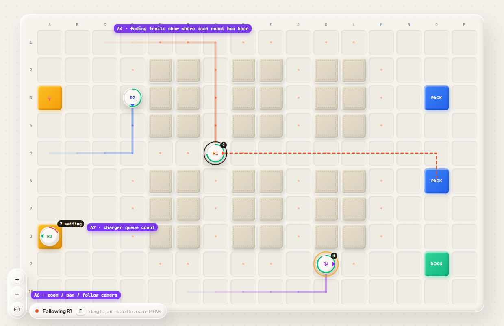

### A4. Fading trails (S)
Robots already glide between cells and show a heading nose. This adds a short trail in each robot's colour that fades out, so you can see where every robot has just been. It would be a new **Trails** layer toggle (`T`).

### A6. Map camera: zoom, pan and follow (M)
Scroll to zoom, drag to pan, and press `F` to follow the selected robot. This matters for bigger custom layouts.

### A7. Charger queue count (S)
Robots already have a battery ring. This adds a "2 waiting" badge on a charger when more than one robot needs it.

---

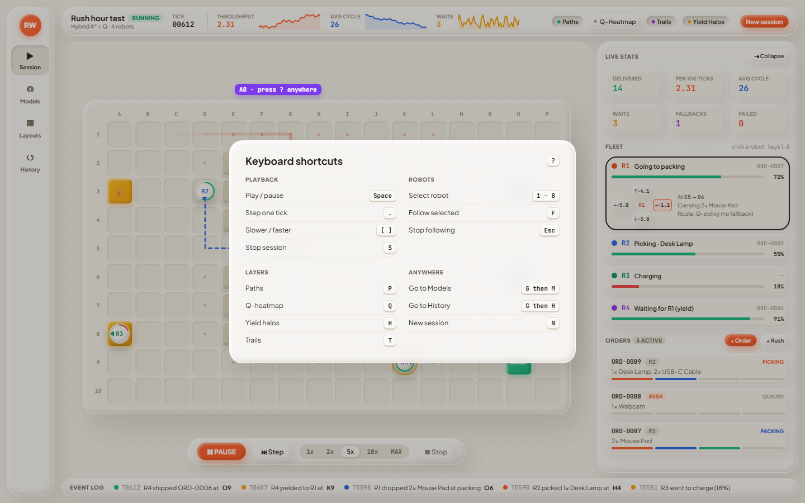

### A8. Keyboard shortcut overlay (S)
Pressing `?` shows every shortcut. Today they're only discoverable from tooltips. The mockup also suggests a few new ones (`.` to step, `[ ]` to change speed, `F` to follow, `G M` to jump to a view).

---

## B. Models (training)

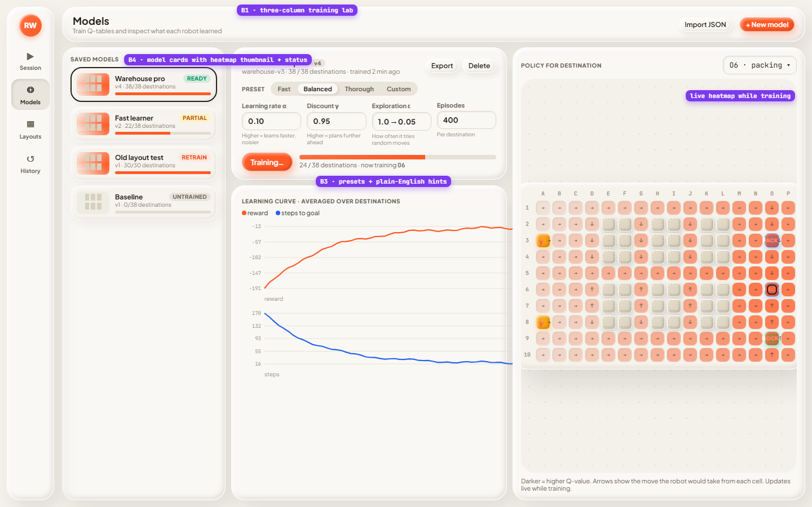

### B1. Three-column training lab (M), *recommended*
Model cards on the left, training controls and learning curves in the centre, and a big policy heatmap on the right that updates live while training runs. The create-model form moves into a "+ New model" modal.

### B3. Hyperparameter presets and inline hints (S)
Add Fast / Balanced / Thorough presets, with a one-line explanation under each field ("Higher = plans further ahead").

### B4. Model cards (S)
Each saved model gets a mini heatmap thumbnail, a progress bar of trained destinations, and a status badge: READY, PARTIAL, RETRAIN (the layout changed) or UNTRAINED.

---

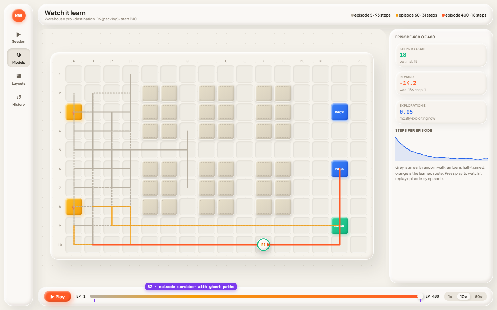

### B2. Watch it learn (L)
Scrub through training episodes for one destination. Ghost paths show the early random walk (grey), a half-trained route (amber) and the learned route (orange), with steps and reward for the episode you're on. This is the best demo moment in the app. It needs the trainer to save a sample path every N episodes.

---

## C. Layouts (editor)

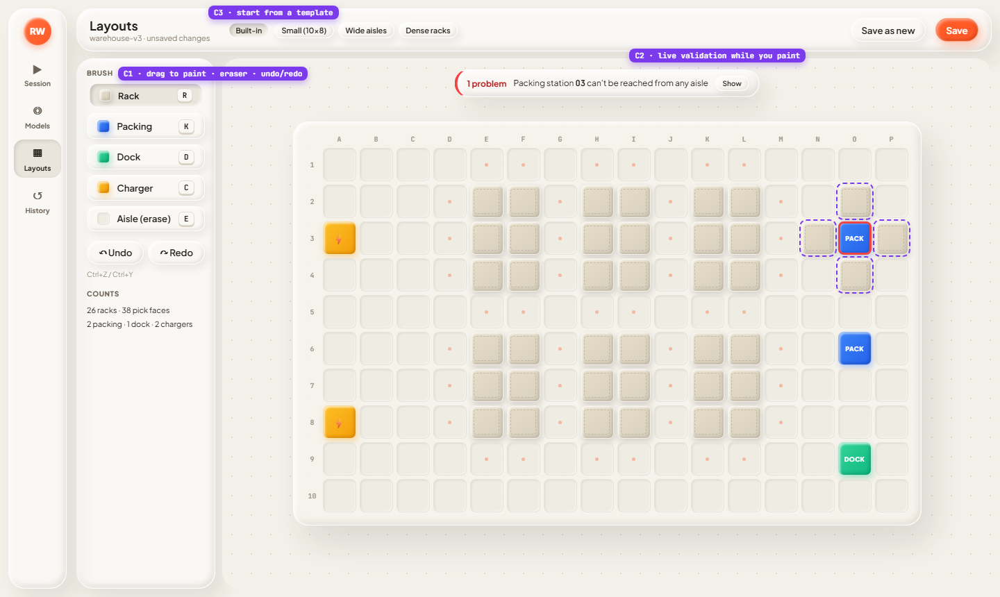

### C1. Drag to paint, plus an eraser and undo/redo (M)
Brushes on the left with shortcut keys, an Aisle brush that erases, drag-to-paint, and Ctrl+Z / Ctrl+Y.

### C2. Live validation (S)
Check the layout as you paint. In the mockup the new racks (dashed purple) box in packing station O3, so the station is outlined in red and a banner explains why. Today you only find out when you press Save.

### C3. Layout templates (S)
Start from Small, Wide aisles or Dense racks, as well as the built-in layout.

---

## D. History & Compare

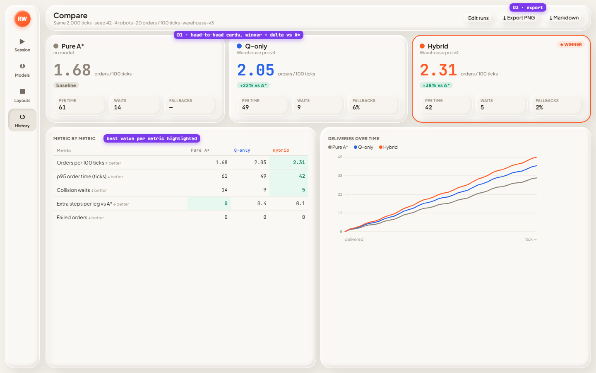

### D1. Head-to-head compare (M), *recommended*
One card per run with the headline throughput, a "+38% vs A*" delta and a WINNER badge. Below that, a metric table that highlights the best value in each row, and a chart of deliveries over time. The point is to make "training helps" obvious at a glance.

### D3. Export (S)
Add Export PNG and Markdown buttons to the compare header so the results can go straight into slides.

---

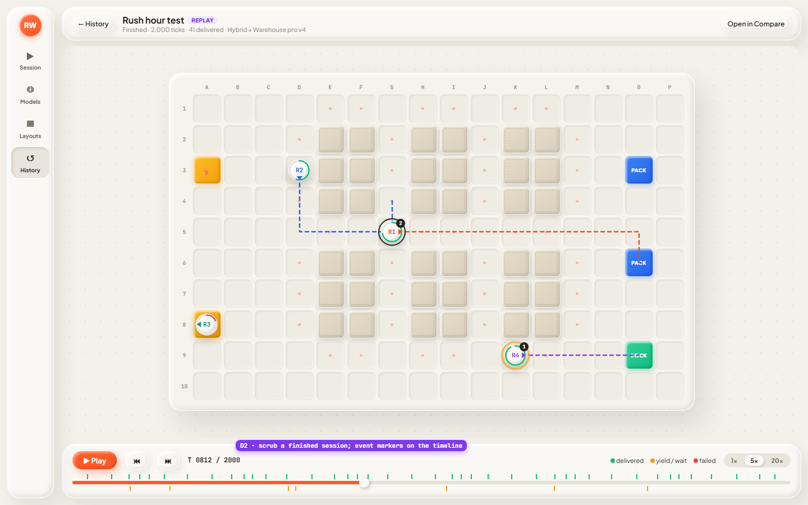

### D2. Session replay (L)
Open a finished session and scrub through it on the map. The timeline has markers for deliveries (green) and waits (amber). This needs the backend to store per-tick snapshots, or to re-simulate the session from its seed.

---

## E. App-wide polish

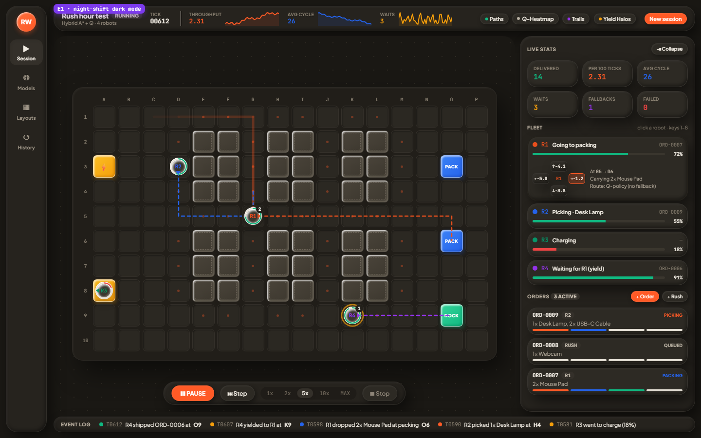

### E1. Dark "night shift" mode (M)
A dark version of the clay palette, with a toggle in the nav rail. It's easier to read on a projector in a dark room.

---

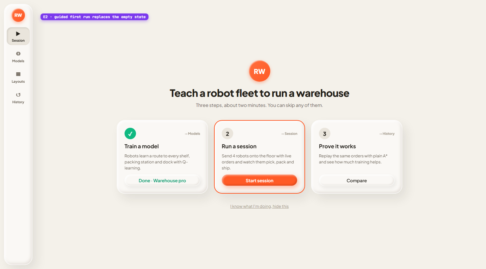

### E2. Guided first run (S)
Replace the empty "No session running" screen with three steps: train a model, run a session, compare against A*. Steps tick off as you complete them, and each card deep-links to the view where you do it.

---

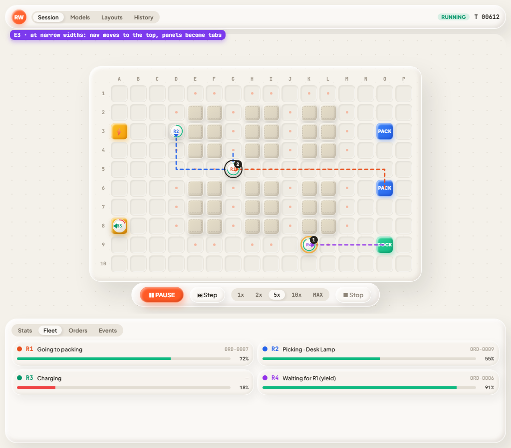

### E3. Narrow and laptop layout (M)
Below ~1100px wide, the nav moves into a top bar, the map takes the full width, and the sidebar turns into tabs underneath (Stats / Fleet / Orders / Events).

---

## My suggested first batch

1. **A1 + A3 + A2** (the Session redesign in the first mockup): it fixes the covered map and makes 8 robots readable.
2. **D1** head-to-head compare: it's the payoff screen for the whole project.
3. **E2** guided first run: new people know where to start.
4. **B1 + B4** training lab.

**B2** (watch it learn) and **D2** (replay) are the biggest "wow" features, but they're also the biggest jobs and need backend changes, so I'd do them second.
